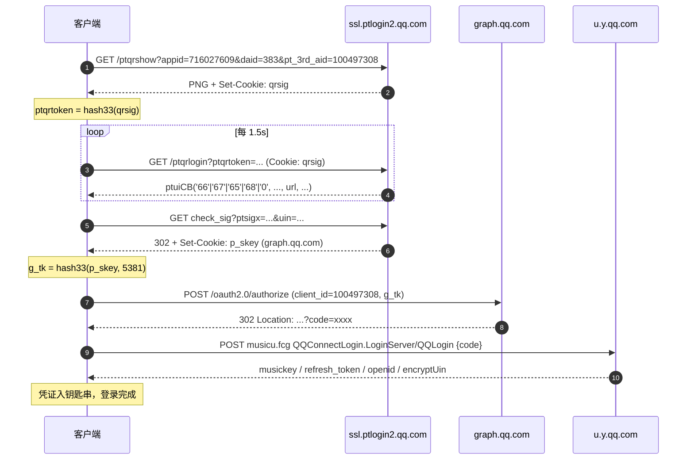
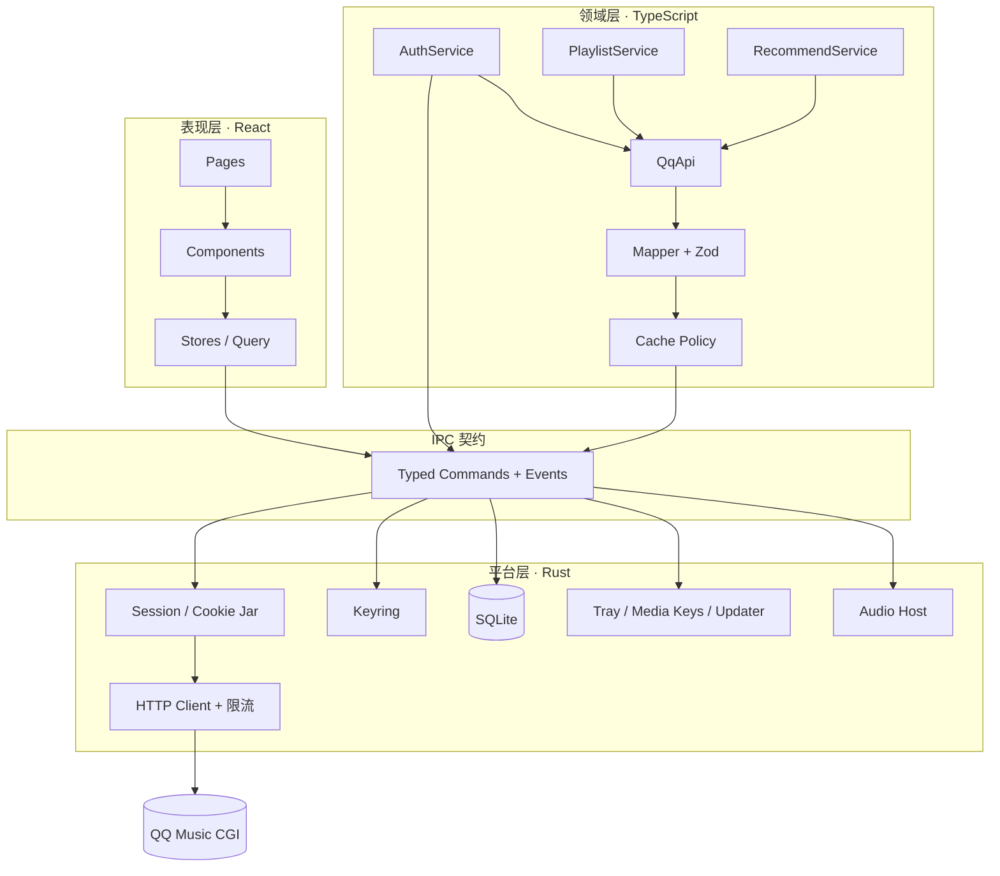
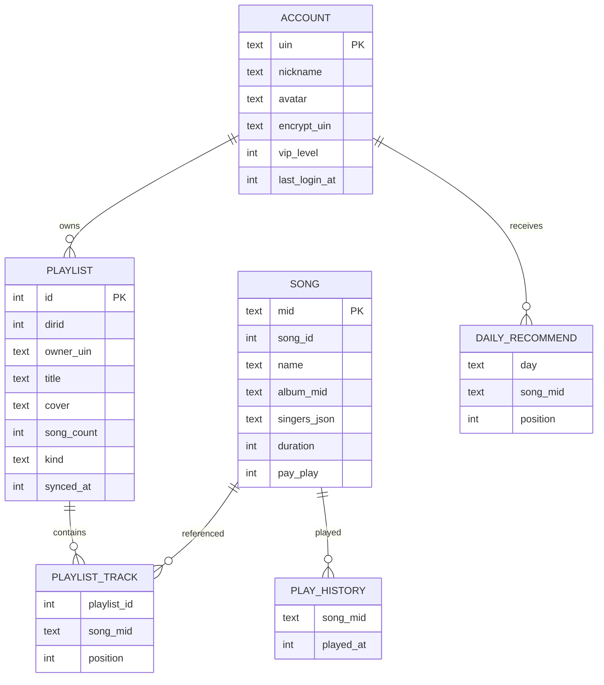
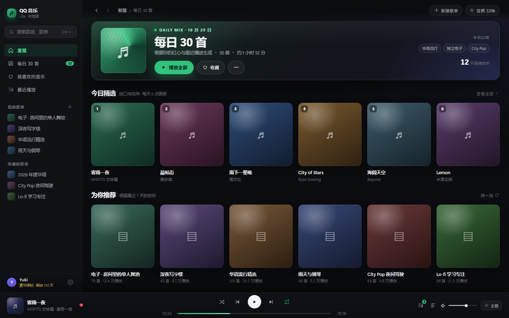
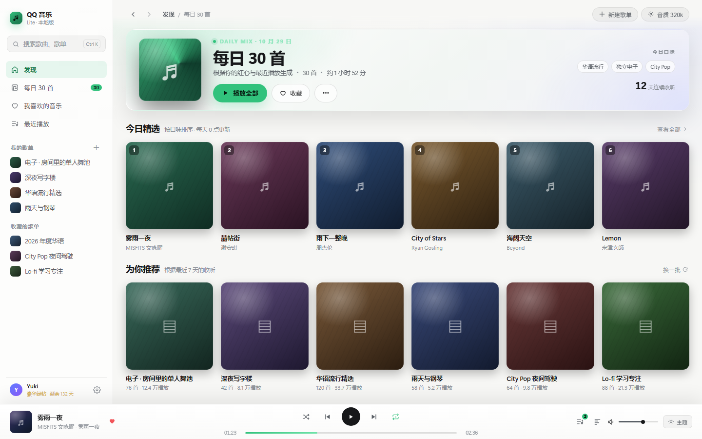

# 轻量 QQ 音乐桌面客户端 · 调研与架构设计

| 项 | 内容 |
|---|---|
| 文档版本 | v0.1（调研稿） |
| 日期 | 2026-10-29 |
| 目标读者 | 产品 / 前端 / 客户端开发 |
| 结论 | **技术可行**。扫码登录、歌单、收藏、歌曲详情、每日 30 首、推荐均可通过 Web CGI 复刻；主要风险不在技术，而在**接口稳定性**与**账号/版权合规**。 |
| 推荐方案 | Tauri 2 + React 19 + TypeScript 领域层 + Rust 薄平台层；SQLite 本地缓存；HTML5 Audio 起步、原生播放器可插拔 |

> 读法：先看 §0 结论；评估可行性看 §2–3；拍板技术栈看 §4；准备开工看 §5 与 §10；UI 直接看 §7 和可交互预览。

---

## 0. 结论先行（TL;DR）

**能不能做？能。** 本次调研在 2026-10-29 实际打通了二维码生成与状态轮询、歌单详情、歌曲详情、歌词、推荐流等匿名链路；登录态链路（qqmusic_key 换取、我的歌单、每日 30 首、播放直链）与三份独立开源实现逐行比对，协议一致。唯一没有在本次调研中完成的是"真人扫码"这一步，因为它必须由账号持有人用手机确认。

**怎么做最合适？**

- **壳**：Tauri 2。安装包 5–12 MB，内存显著低于 Electron；用系统 WebView2，不捆绑 Chromium。
- **核**：把"登录态 + 网络 + 凭证 + 本地库"收在 Rust 侧（约 1–1.5k 行），业务编排与数据建模放在 TypeScript 侧。这样 JS 永远拿不到 `qm_keyst`，同时新增接口、新增功能仍然是纯 TS 的轻量迭代。
- **界面**：React + Vite + Zustand + TanStack Query/Virtual，自建设计 token；三栏布局 + 底部播放条，暗色为主、封面取色渐变。
- **存储**：SQLite（WAL）+ 分级 TTL 缓存；凭证单独放系统钥匙串（Windows Credential Manager）。
- **播放**：先用 WebView 的 `<audio>`（支持 MP3/AAC/FLAC），把 `PlayerBackend` 抽象出来，后续可换 `rodio`/`symphonia` 原生后端做无缝播放、淡入淡出。

**三条硬约束，建议先接受再开工：**

1. 这是**非官方接口**，QQ 音乐没有面向个人开发者、可直接读取用户歌单的公开 OpenAPI；接口随客户端版本漂移是常态，必须做"接口层隔离 + 快速热修"。
2. 扫码登录拿到的 `qm_keyst` 是账号级凭证，**等于账号密码**；泄露即账号风险。必须进钥匙串、不进日志、不进前端、不落明文。
3. 不要做付费绕过。`payplay`/VIP 曲目拿不到 `purl` 是正常的，正确行为是降级音质或提示"无版权/需会员"，而不是破解。

---

## 1. 需求与边界

### 1.1 需求拆解

| 优先级 | 功能 | 说明 | 依赖 |
|---|---|---|---|
| P0 | 扫码登录 | QQ 扫码为主，微信扫码可选；登录态持久化 + 自动续期 | 二维码链路 |
| P0 | 我的歌单 | 自建歌单列表、歌单详情、分页加载 | 登录态 |
| P0 | 我的收藏 | 收藏的歌单 / 我喜欢（红心）/ 收藏的专辑 | 登录态 |
| P0 | 歌曲详情 | 歌名、歌手、专辑、时长、封面、音质、版权标识 | 公开接口 |
| P0 | 播放 | 取直链、播放/暂停/切歌、进度、音量、播放模式 | 登录态 + 音频 |
| P0 | 每日 30 首 | 每日推荐歌单，按天缓存 | 登录态 |
| P1 | 推荐 | 首页推荐流、猜你喜欢、私人雷达、推荐歌单 | 登录态 |
| P1 | 搜索 | 单曲/歌单/歌手，联想词 | 公开/登录 |
| P1 | 歌词 | LRC + 翻译，逐行滚动 | 公开 |
| P1 | 最近播放 / 播放队列 | 本地记录，队列恢复 | 本地 |
| P2 | 收藏操作 | 红心、加/删歌单 | 登录态 + 写接口 |
| P2 | 评论 / MV / 播客 | 可选扩展 | 公开/登录 |
| P2 | 桌面歌词 / 全局快捷键 / 托盘 | 桌面体验 | Tauri |
| P3 | 多音源（网易云等） | Provider 抽象后的自然扩展 | 架构 |

### 1.2 非目标（本期不做）

- 不做社交、直播、音乐人后台、票务。
- 不做服务端账号体系与多端同步（本地单机，数据只在本机）。
- 不做付费内容破解、批量下载、刷播放量。
- 不做上架应用商店（合规风险高，建议个人使用/开源自编译）。

### 1.3 约束

- 资源：空闲内存目标 ≤150 MB，安装包 ≤12 MB，冷启动 ≤1.2 s。
- 扩展：新增一个页面/接口不超过"1 个目录 + 1 处注册"。
- 体验：UI 简洁，暗色优先，操作路径 ≤3 步到播放。
- 平台：Windows 10/11 优先，架构上保留 macOS/Linux。

---

## 2. 可行性验证（实测记录）

> 环境：Windows，Node.js 22（内置 fetch），2026-10-29。以下均为**匿名**请求，未使用任何账号。

| # | 链路 | 请求 | 实测结果 | 结论 |
|---|---|---|---|---|
| 1 | 二维码生成 | `GET ssl.ptlogin2.qq.com/ptqrshow?appid=716027609...` | `200`，446 B PNG，`Set-Cookie: qrsig=...`（128 字符） | ✅ 可用 |
| 2 | 二维码状态 | `GET ssl.ptlogin2.qq.com/ptqrlogin?ptqrtoken=hash33(qrsig)` | `ptuiCB('66','0','','0','二维码未失效。','')` | ✅ 状态机正确 |
| 3 | 歌单详情 | `music.srfDissInfo.DissInfo / CgiGetDiss` | `code 0`，76 首，含 `dirinfo`、`songlist` | ✅ 可用 |
| 4 | 歌曲详情 | `music.pf_song_detail_svr / get_song_detail` | `code 0`，含 `track_info`、`file` 各音质体积 | ✅ 可用 |
| 5 | 歌词 | `music.musichallSong.PlayLyricInfo / GetPlayLyricInfo` | `code 0`，base64 LRC | ✅ 可用 |
| 6 | 推荐流 | `music.recommend.RecommendFeed / get_recommend_feed` | `code 0`，8 个 shelf（未登录为大众内容） | ✅ 可用 |
| 7 | 播放直链（未登录） | `music.vkey.GetVkey / UrlGetVkey` | `retcode 104009`，`purl` 为空，`msg: invalidq` | ⚠️ 必须登录 |
| 8 | 我的歌单（未登录） | `music.musicasset.PlaylistBaseRead / GetPlaylistByUin` | `code 80030`，空列表 | ⚠️ 必须登录 |
| 9 | 真人扫码闭环 | `ptqrlogin → check_sig → oauth → QQLogin` | 未执行（需账号持有人） | 🟡 代码路径已与 3 份实现比对 |

**判断**：匿名只读接口（歌单/歌曲/歌词/推荐流）可以直接做"未登录浏览"；个性化与播放必须登录。这正好可以设计成"先逛后登录"的产品路径。

### 2.1 关键不确定性

| 不确定性 | 影响 | 验证方式 |
|---|---|---|
| 扫码后是否触发二次验证（短信/设备确认） | 新设备/异地登录可能要求额外验证 | M0 用真实账号跑通，记录 `ptuiCB` 文案分支 |
| `qm_keyst` 有效期与续期是否稳定 | 掉登录会打断使用 | 记录 `keyExpiresIn`，用 `refresh_token` 续期，失败再扫码 |
| 接口字段漂移 | 某天突然空白 | 用 zod 做运行时校验，失败上报而非白屏 |
| 风控（频率/并发） | 限流、验证码、甚至封号 | 串行化 + 退避 + 缓存，避免高频轮询 |

---

## 3. QQ 音乐接口调研

### 3.1 协议总览

QQ 音乐 Web 端不是一套 REST，而是**两代 CGI 框架并存**：

| 框架 | 入口 | 特征 | 用途 |
|---|---|---|---|
| 老 CGI | `c.y.qq.com/*.fcg`（GET/POST 表单） | 扁平 query 参数、`format=json`、`g_tk=5381` | 用户主页、早期歌单 |
| 统一 CGI | `u.y.qq.com/cgi-bin/musicu.fcg`（POST JSON） | `{comm, req_0:{module,method,param}}` | 当前主力，几乎覆盖全部业务 |
| 签名 CGI | `u6.y.qq.com/cgi-bin/musics.fcg?sign=zzc...` | 需要 `zzcSign`，App 端协议 | 少数 App 专属能力、续期 |

统一 CGI 的请求骨架：

```json
{
  "comm": { "ct": 24, "cv": 4747474, "uin": "0", "format": "json" },
  "req_0": {
    "module": "music.srfDissInfo.DissInfo",
    "method": "CgiGetDiss",
    "param": { "disstid": 7011264340, "song_num": 500 }
  }
}
```

返回：

```json
{ "code": 0, "req_0": { "code": 0, "data": { ... } } }
```

`comm` 的 `ct/cv` 决定"像哪个客户端"，同一接口不同 `comm` 返回结构可能不同：

| 端 | comm | 说明 |
|---|---|---|
| Web | `ct=24, cv=4747474, platform=yqq.json` | 默认，结构最稳定 |
| Desktop | `ct=19, cv=2201` | 桌面端，部分搜索接口需要 |
| App | `ct=11, cv=13020508, tmeAppID=qqmusic` | 写"我喜欢"、移动端推荐流必须 |

**必带的头**：`Referer: https://y.qq.com/`、桌面 Chrome UA。缺 Referer 时部分接口返回空。

### 3.2 扫码登录完整链路

QQ 扫码登录本质是"QQ 互联 OAuth 借道"，分两段：**拿 QQ 的 p_skey** → **换 QQ 音乐的 musickey**。



#### 步骤明细

| 步 | 方法 | 地址 | 关键参数 / Cookie | 结果 |
|---|---|---|---|---|
| 1 | GET | `https://ssl.ptlogin2.qq.com/ptqrshow` | `appid=716027609&e=2&l=M&s=3&d=72&v=4&t=<rand>&daid=383&pt_3rd_aid=100497308` | PNG；`qrsig` |
| 2 | 计算 | — | `ptqrtoken = hash33(qrsig)` | 32 位整数 |
| 3 | GET | `https://ssl.ptlogin2.qq.com/ptqrlogin` | `u1=https%3A%2F%2Fgraph.qq.com%2Foauth2.0%2Flogin_jump&ptqrtoken=...&ptredirect=0&h=1&t=1&g=1&from_ui=1&ptlang=2052&action=0-0-<ts>&js_ver=20102616&js_type=1&pt_uistyle=40&aid=716027609&daid=383&pt_3rd_aid=100497308&has_onekey=1` | `ptuiCB(...)` |
| 4 | GET | `https://ssl.ptlogin2.graph.qq.com/check_sig` | `uin, pttype=1, service=ptqrlogin, nodirect=0, ptsigx, s_url=...` | 设置 `p_skey` |
| 5 | POST | `https://graph.qq.com/oauth2.0/authorize` | 表单：`client_id=100497308, redirect_uri=https://y.qq.com/portal/wx_redirect.html?login_type=1&surl=..., scope=get_user_info,get_app_friends, g_tk, ui=<uuid>` | 302 带 `code` |
| 6 | POST | `https://u.y.qq.com/cgi-bin/musicu.fcg` | `QQConnectLogin.LoginServer / QQLogin {code}`，`comm.tmeLoginType=2` | 凭证 JSON |

#### 状态机

| `ptuiCB` code | 含义 | UI 行为 |
|---|---|---|
| `66` | 未扫描 / 未失效 | 继续轮询（1.5–2 s） |
| `67` | 已扫描，待确认 | 显示"请在手机上确认" |
| `65` | 二维码已失效 | 停止轮询，展示"刷新二维码" |
| `68` | 用户取消 | 停止轮询，回到初始态 |
| `0` | 登录成功 | 解析第 3 个参数（check_sig URL）继续 |
| 其他 | `本次登录需要...` 等 | 展示文案，降级到"在浏览器中登录"兜底 |

#### 两个容易踩的坑

1. **Cookie 域**：`qrsig` 在 `ptlogin2.qq.com`，`p_skey` 在 `graph.qq.com`。必须用带域匹配的 cookie jar（Rust `cookie_store` / `reqwest_cookie_store`），不要手动拼一个全局 Cookie 头。
2. **guid 必须稳定**：它是设备标识，参与风控。持久化一个随机 UUIDv4，**不要**每次登录从 `qrsig` 派生（qrsig 每次都变）。注意区分 `guid`（设备级、持久）与 `ui`（授权页的界面标识、可每次随机），两者不要混用。

### 3.3 凭证与续期

登录成功返回的关键字段：

| 字段 | 含义 | 存放 |
|---|---|---|
| `musicid` / `str_musicid` | QQ 号（数字/字符串） | DB（非密） |
| `musickey` | 即 `qm_keyst` / `qqmusic_key`，请求鉴权核心 | 钥匙串 |
| `refresh_key` / `refresh_token` | 续期凭证 | 钥匙串 |
| `access_token` / `openid` | OAuth 续期参数 | 钥匙串 |
| `encryptUin` | 加密 UIN，查收藏歌单要用 | DB（非密） |
| `keyExpiresIn` | 有效期（秒），常见 7,776,000 ≈ 90 天 | DB |
| `musickeyCreateTime` | 签发时间 | DB |

续期调用：

```
music.login.LoginServer / Login
{ openid, refresh_token, refresh_key, musickey, loginMode: 2, musicid, access_token, expired_in }
```

策略：启动时若 `now > createTime + keyExpiresIn - 24h` 则静默续期；失败则标记"登录过期"，引导重新扫码。**不要**等 401 再处理，播放链路会卡顿。

请求鉴权就是把凭证拼进 Cookie：

```
uin=<musicid>; qqmusic_uin=<musicid>; qm_keyst=<musickey>; qqmusic_key=<musickey>; guid=<device-id>
```

### 3.4 业务接口清单

| 功能 | module / method | 关键参数 | 登录 | 备注 |
|---|---|---|---|---|
| 我的歌单（自建） | `music.musicasset.PlaylistBaseRead / GetPlaylistByUin` | `uin` | ✅ | `dirId=201` 即"我喜欢" |
| 收藏的歌单 | `music.musicasset.PlaylistFavRead / CgiGetPlaylistFavInfo` | `uin=encryptUin, offset, size` | ✅ | 分页 |
| 歌单详情 | `music.srfDissInfo.DissInfo / CgiGetDiss` | `disstid, dirid, song_begin, song_num, userinfo=1, orderlist=1` | ❌ | 公开歌单匿名可读；`disstid=0` 查"我喜欢"时传 `dirid=201` + `enc_host_uin` |
| 每日 30 首 | `music.recommend.RecommendFeed / get_recommend_feed` | `direction=0, page=1, v_cache=[], v_uniq=[], s_num=0` | ✅ | 在 `v_shelf[].v_niche[].v_card[]` 里找 `title == "每日30首"`，其 `id` 是歌单 id |
| 首页推荐流 | 同上 | 同上 | ✅ | 卡片 `type`：200 歌曲 / 500 歌单 / 700 功能 / 900 入口 |
| 推荐歌单广场 | `music.playlist.PlaylistSquare / GetRecommendFeed` | `From, Size` | ❌ | 编辑精选 |
| 猜你喜欢 | `music.radioProxy.MbTrackRadioSvr / get_radio_track` | `id=99, num=10, from=0, scene=0` | ✅ | 个性电台 |
| 私人雷达 | `music.recommend.TrackRelationServer / GetRadarSong` | `Page, ReqType=0` | ✅ | 分页，`HasMore` |
| 搜索（桌面） | `music.search.SearchCgiService / DoSearchForQQMusicDesktop` | `query, num_per_page, page_num, search_type` | 建议✅ | 需 Desktop comm |
| 搜索建议 | `c.y.qq.com/splcloud/fcgi-bin/smartbox_new.fcg` | `key` | ❌ | 老接口，返回联想词 |
| 歌曲详情 | `music.pf_song_detail_svr / get_song_detail` | `song_mid` | ❌ | 含 `track_info.file` 各音质体积 |
| 批量歌曲 | `music.trackInfo.UniformRuleCtrl / CgiGetTrackInfo` | `mids[]` | ❌ | 列表页补数据 |
| 歌词 | `music.musichallSong.PlayLyricInfo / GetPlayLyricInfo` | `songMID, songID` | ❌ | `lyric` 是 base64，另有 `trans` |
| 播放直链 | `music.vkey.GetVkey / UrlGetVkey` | `filename[], songmid[], songtype[], guid, uin, loginflag=1, platform=20` | ✅ | 见 3.5 |
| 红心 | `music.musicasset.PlaylistDetailWrite / AddSonglist` | `dirId=201, v_songInfo[]` | ✅ | **必须 App comm**，Web comm 返回 80105 |
| 取消红心 | 同上 `DelSonglist` | 同上 | ✅ | |
| 用户资料 | `c6.y.qq.com/rsc/fcgi-bin/fcg_get_profile_homepage.fcg` | `userid, g_tk=hash33(musickey,5381)` | ✅ | 老接口，返回昵称/头像/encrypt_uin |
| 会员信息 | `VipLogin.VipLoginInter / vip_login_base` | — | ✅ | 判断音质上限 |
| 收藏的专辑 | `c.y.qq.com/fav/fcgi-bin/fcg_get_profile_order_asset.fcg` | `userid, reqtype=2, sin, ein` | ✅ | 老接口，可作为 P2 |

> `songtype`：普通单曲为 `0`，部分曲目为 `1`/`13`（伴唱、试听等）。从 `track_info.type` 透传即可。

### 3.5 播放直链（vkey）

```
filename = <prefix><media_mid><media_mid><ext>
prefix: M500=128k mp3 / M800=320k mp3 / F000=FLAC / C400=m4a(AAC) / A000=ape
```

例：`M800003rJSwm3TechU003rJSwm3TechU.mp3`（mid 重复两次是协议要求，不是笔误）。

返回 `midurlinfo[].purl`，拼上 `sip[0]` 域名即播放地址：

```
https://isure.stream.qqmusic.qq.com/<purl>
```

规则：

- `purl` 为空 → 无版权 / 需要会员 / 需要购买。**按音质降级重试**：FLAC → 320 → 128 → 试听片段。
- 直链有时效（小时级），不要长期缓存；播放 403 时静默重取一次。
- `media_mid` 与 `songmid` 可能不同（合唱/多版本），优先用 `file.media_mid`。
- 请求必须带 `uin` 与 `qm_keyst`，否则 `104009 invalidq`（本次已实测）。

### 3.6 签名与风控

| 机制 | 何时需要 | 实现 |
|---|---|---|
| `g_tk` | 老 CGI / OAuth authorize | `hash33(p_skey 或 musickey, 5381)` |
| `ptqrtoken` | 扫码轮询 | `hash33(qrsig, 0)` |
| `zzcSign` | `musics.fcg`（App 协议） | SHA1 → 按固定下标取字符 → 异或混淆 → Base64 → `zzc...` |
| `guid` | 全链路设备标识 | 持久化 UUIDv4 |

`hash33` 实现（注意 32 位截断）：

```ts
function hash33(s: string, seed = 0) {
  let e = seed;
  for (let i = 0; i < s.length; i++) e += (e << 5) + s.charCodeAt(i);
  return e & 0x7fffffff;
}
```

**风控建议**：所有请求串行 + 最小间隔 150–300 ms；同一资源合并请求；失败指数退避；不要并发刷推荐流；不要模拟"刷播放时长"。

### 3.7 已知坑清单

1. **Cookie 超长**：部分 Cookie 超过 255 字符会导致请求头异常，只保留 `uin/qqmusic_uin/qm_keyst/qqmusic_key/guid/encryptUin` 即可。
2. **微信登录**：需要 y.qq.com 的开放平台 appid（`wx48db31d50e334801`），链路是长轮询 `lp.open.weixin.qq.com/connect/l/qrconnect`，比 QQ 扫码多一层；建议 P1 再做。
3. **`GetPlaylistByUin` 返回 80030**：未登录或 uin 不匹配；不是接口坏了。
4. **"我喜欢"写操作**：Web comm 被拒（80105），必须 `ct=11, cv=13020508, tmeAppID=qqmusic`；且 musicu 请求必须带 `g_tk=hash33(musickey, 5381)`，缺了直接返回 `500026`（读接口不受影响，容易误判成账号问题）。
5. **每日 30 首不是固定歌单 id**：每天由推荐流下发，必须"先取 feed 再取详情"，并按日期缓存。
6. **`PlaylistDetail` 分页**：`song_num` 单次最多 500，超过要翻页；顺序用 `orderlist=1`。
7. **搜索结果为空**：检查 `comm` 是否 Desktop（`ct=19`）以及是否缺 Referer。
8. **接口返回 `code=0` 但 `req_0.code!=0`**：业务错误在 `req_0.code`，两层都要判。

---

## 4. 技术选型

### 4.1 候选方案

| 方案 | 安装包 | 空闲内存（同类应用经验值） | UI 表现力 | 开发效率 | 扩展性 | 结论 |
|---|---|---|---|---|---|---|
| **Tauri 2 + WebView2** | 5–12 MB | 90–150 MB | ★★★★★ | ★★★☆（Rust 少量） | ★★★★★ | **推荐** |
| Wails v3 (Go) | 8–15 MB | 90–150 MB | ★★★★★ | ★★★★（Go 简单） | ★★★★☆ | 备选，Go 团队优选 |
| Electron | 90–150 MB | 200–350 MB | ★★★★★ | ★★★★★ | ★★★★★ | 不满足"轻量" |
| Flutter Desktop | 20–40 MB | 120–200 MB | ★★★★☆ | ★★★☆ | ★★★☆ | 自绘引擎，文本/滚动细节成本高 |
| 纯原生（Go + 自绘） | 10–20 MB | 30–60 MB | ★★☆ | ★★ | ★★☆ | 资源最优，UI 与扩展性最差 |
| 本地 Web + 浏览器 | ~0 | 150–250 MB（浏览器标签） | ★★★★★ | ★★★★★ | ★★★★★ | 无桌面集成，不算客户端 |

加权评分（资源 30%、UI 20%、效率 20%、扩展 15%、生态 10%、学习 5%）：

| 方案 | 加权分 |
|---|---|
| Tauri 2 | **4.50** |
| Wails v3 | 4.48 |
| Electron | 4.10 |
| Flutter | 3.83 |
| 纯原生 | 3.05 |

Tauri 与 Wails 基本打平。选 Tauri 的理由：插件生态（updater / sql / single-instance / global-shortcut）、能力制权限模型、Rust 侧能直接复用 `reqwest` + `cookie_store` + `keyring`，以及更好的长期维护性。若团队是 Go 背景，Wails v3 是等价选择（v3 目前为 beta 阶段，需接受 API 仍在收敛）。

**为什么不用 Electron**：它的最低内存代价（约 200 MB）已经超过本项目"空闲 ≤150 MB"的目标；省下来的开发时间不足以抵消"轻量"这一核心卖点。

**为什么不用纯原生自绘**：确实能做到 30–60 MB，但富文本、滚动、动画、输入法、无障碍全部要自己处理，UI 迭代成本是 Web 技术栈的 3–5 倍，且"扩展性强"无从谈起。资源目标应定在"比 Electron 低一半"，而不是"逼近原生"。

> 内存说明：WebView2 会拉起 browser/renderer/GPU/utility 多个进程，总量随页面复杂度上升。社区对比数据给出的 30–40 MB 是"极简窗口"的理想值；音乐类应用（大图、长列表、持续音频）实际落在 90–150 MB 更现实。本文按后者做预算，M1 结束后用 `Get-Process` 实测校准。

### 4.2 前端栈

| 层 | 选型 | 理由 |
|---|---|---|
| 框架 | React 19 + TypeScript 5.9 | 生态、人才、组件库最多 |
| 构建 | Vite 7 | 冷启动快，Tauri 官方模板 |
| 路由 | React Router 7（data router） | 约定简单，支持 loader |
| 服务端状态 | TanStack Query 5 | 缓存、重试、SWR 天然匹配"接口易漂移" |
| 客户端状态 | Zustand 5 | 播放器/会话状态，极少样板 |
| 长列表 | TanStack Virtual | 万级歌曲表 60fps |
| 样式 | CSS Modules + CSS 变量（可选 Tailwind 4） | 设计 token 可控，产物小 |
| 图标 | Lucide（按需引入） | 体积小、风格统一 |
| 校验 | Zod | 接口边界运行时校验，防白屏 |
| 测试 | Vitest + Testing Library + Playwright | 领域层单测 + 关键路径 E2E |

不引入组件库（Ant Design / MUI）：它们的体积与默认视觉都不符合"简洁好看"，自建 12–15 个基础组件更可控。

### 4.3 Rust 侧

| 能力 | crate / 方案 |
|---|---|
| 异步运行时 | `tokio` |
| HTTP | `reqwest`（rustls 或 native-tls） |
| Cookie | `reqwest_cookie_store` + `cookie_store` |
| 序列化 | `serde` / `serde_json` |
| 凭证 | `keyring`（Windows Credential Manager / macOS Keychain） |
| 本地库 | `tauri-plugin-sql`（SQLite，sqlx）或 `rusqlite` |
| 日志 | `tracing` + `tracing-subscriber`（脱敏） |
| 媒体键 | `souvlaki`（Windows SMTC / macOS Now Playing） |
| 单实例 | `tauri-plugin-single-instance` |
| 更新 | `tauri-plugin-updater` |
| 开机自启 | `tauri-plugin-autostart` |

### 4.4 播放方案

| 阶段 | 方案 | 优点 | 缺点 |
|---|---|---|---|
| M1 | HTML5 `<audio>` + Media Session | 零依赖、格式够用（MP3/AAC/FLAC） | 无无缝播放/淡入淡出，格式受 WebView 限制 |
| M3（可选） | `rodio` + `symphonia` 原生解码 | 无缝、EQ、淡入淡出、后台稳定 | 增加 2–4 周，需要自己处理缓冲与设备切换 |

抽象成 `PlayerBackend` 接口，UI 只依赖接口，后续替换不影响页面。

---

## 5. 架构设计

### 5.1 分层



依赖方向严格单向：`UI → 领域 → IPC → 平台`。平台层不认识"歌单""每日推荐"，只知道"会话、HTTP、存储、系统能力"。这样换音乐平台只动领域层，换桌面框架只动平台层。

### 5.2 目录结构

```text
qqmusic-lite/
├─ apps/desktop/
│  ├─ src/                        # React
│  │  ├─ app/                     # 启动、路由、Provider、错误边界
│  │  ├─ features/
│  │  │  ├─ auth/                 # 登录页、二维码卡片
│  │  │  ├─ home/                 # 发现页
│  │  │  ├─ daily/                # 每日 30 首
│  │  │  ├─ library/              # 我的歌单 / 收藏 / 我喜欢
│  │  │  ├─ playlist/             # 歌单详情
│  │  │  ├─ player/               # 播放条、播放页、队列
│  │  │  ├─ search/
│  │  │  └─ settings/
│  │  ├─ shared/
│  │  │  ├─ ui/                   # Button/Input/Sheet/Toast/Skeleton...
│  │  │  ├─ hooks/
│  │  │  ├─ lib/                  # 格式化、颜色、快捷键
│  │  │  └─ styles/tokens.css
│  │  └─ registry.ts              # 特性注册表（唯一新增入口）
│  └─ src-tauri/
│     ├─ src/
│     │  ├─ main.rs
│     │  ├─ commands/             # auth.rs / api.rs / secret.rs / player.rs
│     │  ├─ net/                  # client.rs / cookie.rs / allowlist.rs
│     │  ├─ session.rs
│     │  └─ tray.rs
│     └─ capabilities/default.json
├─ packages/
│  ├─ core/                       # 领域层（可单测，无 DOM 依赖）
│  │  ├─ src/qq/                  # endpoints / mappers / types
│  │  ├─ src/services/            # auth / playlist / recommend / player
│  │  ├─ src/cache/
│  │  └─ src/provider.ts          # MusicProvider 接口
│  └─ shared-types/               # IPC DTO + zod schema
└─ docs/
```

### 5.3 关键抽象

**业务 IPC 只用 6 组命令**，保持面窄（本地库另由 `tauri-plugin-sql` 提供 `db.select/db.execute`，只在 repository 层使用，不混进业务命令）：

| 命令 | 入参 | 出参 | 说明 |
|---|---|---|---|
| `auth.qr_start` | `{ kind: 'qq' \| 'wx' }` | `{ qrId, imageDataUrl, expiresAt }` | 二维码只以 data URL 回传 |
| `auth.qr_poll` | `{ qrId }` | `{ state, account? }` | `waiting/scanned/confirmed/expired/cancelled` |
| `auth.restore` | — | `{ account? }` | 启动恢复 + 静默续期 |
| `auth.logout` | — | `void` | 清钥匙串 + 会话 |
| `api.call` | `{ module, method, param, comm? }` | `unknown` | 自动注入当前会话 Cookie，域名白名单 |
| `sys.info` | — | `{ version, webview, platform }` | 诊断 |

播放/托盘/媒体键走 **事件**（Rust → JS），不占用命令面。

> 安全边界：`comm.uin / qm_keyst / qqmusic_key` 由 Rust 用当前会话强制覆盖，JS 传入无效；`module/method` 建议再做白名单，避免渲染层被 XSS 后把 `api.call` 当成任意接口代理。

```ts
// packages/core/src/provider.ts
export type Capability =
  | 'search' | 'playlist' | 'favorite' | 'daily' | 'recommend' | 'lyric' | 'stream';

export interface MusicProvider {
  readonly id: string;                 // 'qq' | 'netease' | ...
  readonly capabilities: ReadonlySet<Capability>;
  search(q: string, page: number): Promise<Page<Song>>;
  playlist(id: PlaylistId): Promise<Playlist>;
  playlistTracks(id: PlaylistId, offset: number, limit: number): Promise<Page<Song>>;
  daily(): Promise<Playlist & { tracks: Song[] }>;
  recommend(): Promise<FeedSection[]>;
  lyric(song: Song): Promise<Lyric>;
  stream(song: Song, quality: Quality): Promise<StreamInfo>;
}
```

`QqProvider` 是第一个实现。以后加网易云，只是新增 `providers/netease/` 并向注册表注册，页面无感。

**特性注册表**（新增页面只改这里）：

```ts
// apps/desktop/src/registry.ts
export interface FeatureModule {
  id: string;
  nav?: { title: string; icon: Icon; order: number };
  routes?: RouteObject[];
  commands?: CommandPaletteItem[];
  boot?: (ctx: AppContext) => void | Promise<void>;
}

export const features: FeatureModule[] = [
  homeFeature,
  dailyFeature,
  libraryFeature,
  playlistFeature,
  searchFeature,
  playerFeature,
  settingsFeature,
];
```

**数据访问**：`api.call` 是唯一出口，所有返回先过 zod：

```ts
const DissSchema = z.object({
  dirinfo: z.object({ id: z.coerce.number(), title: z.string(), picurl: z.string().optional() }),
  songlist: z.array(SongSchema).default([]),
  total_song_num: z.coerce.number().default(0),
});

export async function fetchDiss(disstid: number, dirid = 0, begin = 0, num = 500) {
  const raw = await call('music.srfDissInfo.DissInfo', 'CgiGetDiss', {
    disstid, dirid, song_begin: begin, song_num: num,
    userinfo: 1, orderlist: 1, onlysonglist: 0,
  });
  return DissSchema.parse(raw);
}
```

校验失败不要抛到页面：记录 `endpoint + 字段路径`，返回上次缓存，UI 用一条"数据可能不是最新"的轻提示。接口漂移时这是唯一能保住体验的做法。

### 5.4 一次播放的数据流

```text
用户点击歌曲
  → playerStore.enqueue(song)
  → StreamService.get(song, quality)
      → 缓存命中（<20min）? 直接返回
      → api.call(music.vkey.GetVkey / UrlGetVkey)
      → purl 为空? 降级音质重试（flac→320→128）
      → 返回 { url, quality, expiresAt }
  → <audio src> 播放
  → 并行：lyric(song) / 封面 / 上报最近播放
  → 播放结束：next()（顺序/随机/单曲）
```

失败策略：连续 3 首失败才停止并提示；单首失败静默跳过。

### 5.5 扩展点

| 想加什么 | 改哪里 | 工作量 |
|---|---|---|
| 新页面 | `features/xxx` + `registry.ts` 一行 | 0.5–2 天 |
| 新接口 | `packages/core/src/qq/endpoints.ts` + zod schema | 0.5 天 |
| 新音源 | 实现 `MusicProvider` + 注册 | 3–5 天 |
| 新播放后端 | 实现 `PlayerBackend` + 设置项切换 | 3–5 天 |
| 主题 | `tokens.css` 增加一组变量 | 0.5 天 |
| 插件（远期） | WASM 沙箱 + 权限清单 | 暂不做 |

---

## 6. 数据设计

### 6.1 ER



### 6.2 表结构（SQLite）

```sql
PRAGMA journal_mode = WAL;
PRAGMA foreign_keys = ON;

CREATE TABLE account (
  uin            TEXT PRIMARY KEY,
  nickname       TEXT NOT NULL DEFAULT '',
  avatar         TEXT NOT NULL DEFAULT '',
  encrypt_uin    TEXT NOT NULL DEFAULT '',
  vip_level      INTEGER NOT NULL DEFAULT 0,
  key_expires_at INTEGER NOT NULL DEFAULT 0,
  last_login_at  INTEGER NOT NULL DEFAULT 0
);

CREATE TABLE playlist (
  id          INTEGER NOT NULL,
  owner_uin   TEXT    NOT NULL DEFAULT '',
  dirid       INTEGER NOT NULL DEFAULT 0,
  title       TEXT    NOT NULL,
  cover       TEXT    NOT NULL DEFAULT '',
  description TEXT    NOT NULL DEFAULT '',
  song_count  INTEGER NOT NULL DEFAULT 0,
  play_count  INTEGER NOT NULL DEFAULT 0,
  kind        TEXT    NOT NULL DEFAULT 'created', -- created|collected|liked|daily
  synced_at   INTEGER NOT NULL DEFAULT 0,
  PRIMARY KEY (id, owner_uin)
);

CREATE TABLE song (
  mid           TEXT PRIMARY KEY,
  song_id       INTEGER NOT NULL DEFAULT 0,
  name          TEXT    NOT NULL,
  album_mid     TEXT    NOT NULL DEFAULT '',
  album_name    TEXT    NOT NULL DEFAULT '',
  singers_json  TEXT    NOT NULL DEFAULT '[]',
  cover         TEXT    NOT NULL DEFAULT '',
  duration      INTEGER NOT NULL DEFAULT 0,
  pay_play      INTEGER NOT NULL DEFAULT 0,
  updated_at    INTEGER NOT NULL DEFAULT 0
);

CREATE TABLE playlist_track (
  playlist_id INTEGER NOT NULL,
  owner_uin   TEXT    NOT NULL DEFAULT '',
  song_mid    TEXT    NOT NULL,
  position    INTEGER NOT NULL,
  PRIMARY KEY (playlist_id, owner_uin, song_mid)
);
CREATE INDEX idx_track_playlist ON playlist_track(playlist_id, owner_uin, position);

CREATE TABLE play_history (
  song_mid  TEXT NOT NULL,
  played_at INTEGER NOT NULL,
  PRIMARY KEY (song_mid, played_at)
);
CREATE INDEX idx_history_time ON play_history(played_at DESC);

CREATE TABLE daily_recommend (
  day      TEXT NOT NULL,          -- YYYY-MM-DD
  song_mid TEXT NOT NULL,
  position INTEGER NOT NULL,
  PRIMARY KEY (day, song_mid)
);

CREATE TABLE setting (
  key   TEXT PRIMARY KEY,
  value TEXT NOT NULL
);
```

**凭证不进 SQLite**。`musickey/refresh_token/openid` 存系统钥匙串，键名 `qqmusic-lite:<uin>`；DB 只存 `key_expires_at` 用于判断续期时机。

### 6.3 缓存策略

| 资源 | TTL | 策略 |
|---|---|---|
| 二维码 | 2 min | 过期即刷新，不缓存 |
| 我的歌单列表 | 10 min | SWR，进页面先出缓存再刷新 |
| 歌单详情 | 10 min | SWR；播放页不等待 |
| 歌曲详情 | 30 天 | 长期，字段缺失才回源 |
| 歌词 | 30 天 | 长期 |
| 播放直链 | 20 min | 403 时立即失效重取 |
| 每日 30 首 | 当日 24:00 | 跨天自动刷新 |
| 推荐流 | 30 min | 下拉刷新可强制 |
| 封面图 | WebView HTTP 缓存 | 不额外落盘（可选离线包） |

TanStack Query 的 `staleTime` 直接映射上表；持久化用自定义 persister 写 SQLite（仅存元数据与列表，不存音频）。

### 6.4 迁移

`tauri-plugin-sql` 内置 migration 数组，版本号递增；每次启动执行。规则：

- 只增字段，不删字段；删字段先标记废弃。
- 每次迁移前 `VACUUM INTO` 备份到 `backup/`，保留最近 3 份。
- 大表加索引用 `CREATE INDEX IF NOT EXISTS`。

---

## 7. UI / UX 设计

### 7.1 设计原则

1. **内容优先**：封面与歌名是主角，装饰（边框、阴影、分隔线）尽量少。
2. **一层景深**：背景用封面主色的低饱和渐变，卡片浮在背景上，不做多层毛玻璃（WebView2 上 `backdrop-filter` 很贵）。
3. **稳定的骨架**：侧栏宽度、播放条高度、列表行高固定，切页不跳动。
4. **暗色默认**：音乐场景夜间多；浅色作为可选项，不是反色补丁。
5. **键盘可达**：所有高频操作有快捷键，`Ctrl+K` 打开命令面板。

### 7.2 信息架构

```text
登录
└─ 主框架
   ├─ 发现（默认）
   │  ├─ 每日 30 首（大卡）
   │  ├─ 为你推荐（横向卡片）
   │  └─ 最近播放
   ├─ 每日 30 首（独立页）
   ├─ 我的音乐
   │  ├─ 我喜欢
   │  ├─ 自建歌单
   │  └─ 收藏的歌单
   ├─ 歌单详情 / 专辑详情 / 歌手详情
   ├─ 搜索
   ├─ 播放页（覆盖层）
   └─ 设置
```

### 7.3 线框图

> 可交互预览见 [`docs/ui-mockup.html`](./ui-mockup.html)（浏览器直接打开，右下角可切换明暗主题）。下面是暗色主题的实际渲染：
>
> 
>
> 

主界面（1280 × 800）：

```text
┌────────────────────┬──────────────────────────────────────────────────────────┐
│  ●  QQ 音乐 · Lite  │  每日 30 首                         [▶ 播放全部]  [⋯]   │
│                    │  10 月 29 日 · 为你精选 30 首                              │
│  ⌘K  搜索           │                                                          │
│                    │  ┌──────────┐ ┌──────────┐ ┌──────────┐ ┌──────────┐      │
│  ◉ 发现            │  │  封面     │ │  封面     │ │  封面     │ │  封面     │      │
│  ○ 每日 30 首       │  │          │ │          │ │          │ │          │      │
│  ○ 我的音乐         │  └──────────┘ └──────────┘ └──────────┘ └──────────┘      │
│                    │   歌名         歌名         歌名         歌名              │
│  ── 歌单 ─────────  │   歌手         歌手         歌手         歌手              │
│  电子·房间里的...   │                                                          │
│  华语流行精选       │  为你推荐                                    [换一批]      │
│  深夜电台           │  ┌────────┐ ┌────────┐ ┌────────┐ ┌────────┐             │
│                    │  │ 歌单卡  │ │ 歌单卡  │ │ 歌单卡  │ │ 歌单卡  │             │
│  ── 收藏 ─────────  │  └────────┘ └────────┘ └────────┘ └────────┘             │
│  我喜欢的音乐       │                                                          │
│  每日 30 首         │                                                          │
│                    │                                                          │
├────────────────────┴──────────────────────────────────────────────────────────┤
│ ◀ ▶  ┌────┐  歌名 — 歌手                 ◀◀  ▶  ▶▶   ♡  🔁  🔊 ────  ☰  ⌃   │
│      │封面│  专辑名                                                    歌词   │
└──────────────────────────────────────────────────────────────────────────────┘
```

播放页（覆盖层，封面取色渐变背景）：

```text
┌──────────────────────────────────────────────────────────────────────────────┐
│  ⌄ 收起                                                             ⋯ 分享   │
│                                                                              │
│              ┌────────────────────┐        ┌──────────────────────────┐      │
│              │                    │        │  歌名                    │      │
│              │      大封面         │        │  歌手 · 专辑             │      │
│              │                    │        │                          │      │
│              │                    │        │  [逐行歌词滚动区]         │      │
│              └────────────────────┘        │                          │      │
│                                            └──────────────────────────┘      │
│   ─────────●───────────────────────────────  01:23 / 04:05                   │
│        ◀◀      ▶      ▶▶      ♡      🔁      🔊 ──────                       │
└──────────────────────────────────────────────────────────────────────────────┘
```

登录页（居中卡片）：

```text
┌──────────────────────────────────────────────────────────────┐
│                                                              │
│                    QQ 音乐 · Lite                            │
│                                                              │
│                 ┌──────────────────────┐                     │
│                 │                      │                     │
│                 │      二维码图片       │                     │
│                 │                      │                     │
│                 └──────────────────────┘                     │
│                   打开手机 QQ 扫一扫                          │
│                   二维码 2 分钟内有效                          │
│                                                              │
│              [ 微信扫码 ]      [ 刷新二维码 ]                  │
│                                                              │
│         登录即表示同意仅在本机使用，凭证不会上传                  │
└──────────────────────────────────────────────────────────────┘
```

### 7.4 设计 token

```css
:root {
  /* 色板：暗色 */
  --bg:            #0d0e11;
  --bg-elevated:   #14161a;
  --surface:       rgba(255, 255, 255, 0.04);
  --surface-hover: rgba(255, 255, 255, 0.07);
  --border:        rgba(255, 255, 255, 0.08);
  --border-strong: rgba(255, 255, 255, 0.14);

  --text:          #f2f3f5;
  --text-secondary:#a1a6ad;
  --text-tertiary: #6b7078;

  --accent:        #31c27c;   /* QQ 音乐绿，只用于主操作/播放态 */
  --accent-press:  #28a86a;
  --danger:        #f2555a;

  /* 尺寸 */
  --sidebar-w:     232px;
  --sidebar-w-min: 64px;
  --player-h:      72px;
  --radius-sm:     8px;
  --radius-md:     12px;
  --radius-lg:     18px;
  --radius-xl:     24px;

  /* 间距：4 的倍数 */
  --sp-1: 4px;  --sp-2: 8px;  --sp-3: 12px; --sp-4: 16px;
  --sp-5: 20px; --sp-6: 24px; --sp-8: 32px; --sp-10: 40px;

  /* 字体 */
  --font-sans: "Segoe UI Variable", "PingFang SC", "HarmonyOS Sans SC",
               "Microsoft YaHei", system-ui, sans-serif;
  --fs-xs: 12px; --fs-sm: 13px; --fs-md: 14px;
  --fs-lg: 16px; --fs-xl: 20px; --fs-2xl: 28px;

  /* 动效 */
  --ease: cubic-bezier(0.2, 0.8, 0.2, 1);
  --dur-fast: 120ms;
  --dur-base: 180ms;
  --dur-slow: 280ms;
}

:root[data-theme="light"] {
  --bg: #f7f7f5;
  --bg-elevated: #fdfdfc;
  --surface: rgba(0, 0, 0, 0.035);
  --surface-hover: rgba(0, 0, 0, 0.06);
  --border: rgba(0, 0, 0, 0.08);
  --text: #17181a;
  --text-secondary: #5c6168;
  --text-tertiary: #8b9097;
}
```

封面取色：用 16×16 缩略图在 canvas 取平均色，写入 `--cover-a/--cover-b`，背景用 `linear-gradient(160deg, var(--cover-a), transparent 60%)`；**不要**对整页做 `backdrop-filter`。

### 7.5 组件清单

| 组件 | 说明 | 关键约束 |
|---|---|---|
| `Sidebar` | 可折叠导航，歌单列表虚拟滚动 | 折叠 64px，仅图标 + tooltip |
| `PlayerBar` | 封面/信息/控制/进度/音量 | 高度固定 72px，drag 进度用 pointer capture |
| `NowPlaying` | 全屏播放页 | 封面 1:1，歌词区独立滚动 |
| `TrackTable` | 歌曲表 | 行高 48px，虚拟滚动，hover 才显示操作 |
| `CoverCard` | 歌单卡 | 1:1，懒加载，骨架屏 |
| `SectionHeader` | 区块标题 + 操作 | 固定 40px |
| `QRCard` | 二维码 + 状态 | 状态机驱动文案，不闪 |
| `Toast` | 轻提示 | 3s 自动消失，最多 3 条 |
| `CommandPalette` | Ctrl+K | 模糊搜索页面/歌曲/操作 |
| `Skeleton` | 骨架 | 与真实布局同尺寸，避免 CLS |

### 7.6 交互与快捷键

| 快捷键 | 行为 |
|---|---|
| `Space` | 播放 / 暂停 |
| `←` / `→` | 快退 / 快进 5s |
| `Ctrl+←` / `Ctrl+→` | 上一首 / 下一首 |
| `Ctrl+K` | 命令面板 |
| `Ctrl+F` | 搜索 |
| `Esc` | 关闭覆盖层 / 清空搜索 |
| `M` | 静音 |

### 7.7 性能约束（设计阶段就定）

- 列表行高固定 + 虚拟滚动，DOM 节点常驻 <300。
- 封面统一 `loading="lazy" decoding="async"`，列表滚动时暂停大图加载。
- 路由级 `React.lazy`，首屏只加载 home + player。
- 禁止在滚动容器上用 `box-shadow`/`filter` 动画；用 `transform`/`opacity`。
- 切歌动画 ≤180ms，避免"每切一首卡一下"。
- 窗口失焦时暂停非必要动画（频谱、呼吸灯）。

---

## 8. 性能与资源预算

### 8.1 预算表

| 指标 | 目标 | 测量方法 |
|---|---|---|
| 安装包 | ≤12 MB | 安装器体积 |
| 安装后磁盘 | ≤40 MB | 目录大小（不含音频缓存） |
| 冷启动 | ≤1.2 s | 进程启动 → 首屏可交互 |
| 热启动 | ≤600 ms | 二次启动 |
| 空闲内存 | ≤150 MB | `Get-Process` 汇总 |
| 播放内存 | ≤200 MB | 播放 320k 时 |
| 空闲 CPU | ≤1% | 任务管理器 60s 均值 |
| 首屏（有缓存） | ≤300 ms | Performance 面板 |
| 列表滚动 | 60 fps | 10k 行快速滚动 |
| 音频缓存 | 默认 2 GB，可调 | 设置项 |

### 8.2 内存构成（估算）

| 进程 | 估算 | 说明 |
|---|---|---|
| 主进程（Rust） | 10–18 MB | 会话、HTTP、SQLite 连接池 |
| WebView2 browser | 30–45 MB | 共享运行时 |
| Renderer | 50–80 MB | React + 列表 + 图片 |
| GPU | 15–30 MB | 合成层，受动画/模糊影响 |
| Utility / Network | 10–20 MB | |
| **合计** | **115–193 MB** | 目标压到 150 MB 以内，靠下面 6 条手段 |

降低内存的具体手段：

1. 单窗口，不做多开；播放页用覆盖层而非新窗口。
2. 不引入重型 UI 库与图标全量包。
3. 图片解码尺寸 = 显示尺寸（`y.gtimg.cn` 用 `T002R300x300M000...` 里的 `R300x300`，`qpic` 用路径尺寸参数，别直接拿原图）。
4. 列表虚拟化，及时释放不可见图片。
5. 避免 `backdrop-filter`、大面积 `filter: blur()`。
6. 音频缓存用文件流，不整段读入内存。

### 8.3 网络

| 场景 | 估算 |
|---|---|
| 首屏（10 张封面 + 30 首歌元数据） | 300–600 KB |
| 歌单详情（500 首） | 400–800 KB |
| 每日 30 首 | 150–300 KB |
| 播放（128k） | ~56 MB/小时 |
| 播放（320k） | ~140 MB/小时 |
| 播放（FLAC） | ~300–600 MB/小时 |

封面走 CDN（`y.gtimg.cn` / `qpic.y.qq.com`），按显示尺寸取图（`R300x300` 这类路径尺寸）；播放直链走 `isure.stream.qqmusic.qq.com`。

---

## 9. 安全、合规与风险

### 9.1 凭证安全

| 措施 | 说明 |
|---|---|
| 钥匙串存储 | `keyring` 写 Windows Credential Manager / macOS Keychain |
| 前端零凭证 | `api.call` 在 Rust 侧注入 Cookie，JS 只传业务参数 |
| 域名白名单 | 仅允许 `*.qq.com`、`*.qqmusic.qq.com`、`*.gtimg.cn`、`*.qpic.cn` |
| 日志脱敏 | `qm_keyst`、`refresh_token`、`openid` 永不落日志 |
| CSP | 禁止内联脚本与外部脚本，`img-src`/`media-src` 限定域名 |
| 崩溃上报 | 默认关闭；开启时剥离 Cookie 与 URL query |

### 9.2 账号风险

- 高频请求、短时间大量切歌、异地登录都可能触发风控。建议：请求串行、缓存优先、不做"刷时长"。
- 扫码登录 = 把账号授权给本机应用；**不要**把 `qm_keyst` 上传到任何服务器。
- 若做多账号，凭证按 `uin` 隔离，切换时重建 cookie jar。

### 9.3 合规

- QQ 音乐用户协议通常禁止未经授权的第三方客户端/接口调用；本项目定位**个人学习与自用**，不分发、不上架、不商业化。
- 不绕过付费：`payplay=1` 且无权限的曲目，只显示不可播，不尝试破解。
- 不提供下载/导出功能，避免版权风险（个人缓存仅用于播放流畅）。
- 开源时附免责声明，不内置任何账号凭证；参考实现中 GPL 代码不要直接复制（见附录许可证）。

### 9.4 风险矩阵

| 风险 | 概率 | 影响 | 缓解 |
|---|---|---|---|
| 接口字段变更 | 高 | 中 | zod 校验 + Provider 隔离 + 远端配置开关 |
| 接口下线/加签 | 中 | 高 | 保留 App 协议（musics.fcg + zzc）作为备胎 |
| 登录态失效 | 高 | 中 | 自动续期 + 过期提示 + 一键重扫 |
| 风控/限流 | 中 | 高 | 串行、退避、缓存、单账号 |
| 版权/ToS | 中 | 高 | 个人自用、不传播、不破解 |
| WebView2 缺失 | 低 | 低 | 安装包内置 bootstrapper 或引导下载 |
| 大列表卡顿 | 中 | 中 | 虚拟滚动 + 图片尺寸控制 |
| 凭证泄露 | 低 | 高 | 钥匙串 + 白名单 + 脱敏 |

---

## 10. 实施计划

### 10.1 里程碑

| 阶段 | 周期 | 交付 | 验收 |
|---|---|---|---|
| **M0 协议验证** | 3–5 天 | 一个 CLI/脚本：扫码登录 → 拉资料/歌单/每日 30 → 导出 JSON | 真实账号跑通；记录所有 `ptuiCB` 分支与字段 |
| **M1 可用 MVP** | 2 周 | Tauri 壳、登录页、我的歌单、歌单详情、播放条、128k 播放、托盘 | 能登录、能选歌、能连续播放 10 首不崩 |
| **M2 完整体验** | 2 周 | 每日 30、我喜欢、收藏歌单、搜索、歌词、缓存、设置、快捷键 | 冷启动 <1.5s；切页无白屏；断网有缓存 |
| **M3 打磨** | 1–2 周 | 主题、播放页、命令面板、离线、自动更新、性能调优 | 空闲内存 <150MB；滚动 60fps |
| **M4 扩展（可选）** | 按需 | 第二音源、原生播放后端、桌面歌词 | Provider 替换不动 UI |

单人全职约 **6–8 周**；两人并行约 **3–4 周**（一人协议+平台，一人 UI）。

### 10.2 任务拆解（M1）

| 任务 | 估时 |
|---|---|
| Tauri 2 脚手架 + CI + 代码规范 | 0.5 天 |
| Rust：HTTP 客户端、cookie jar、域名白名单 | 1 天 |
| Rust：`auth.*` 四个命令 + 钥匙串 | 1.5 天 |
| Rust：`api.call` + 错误模型 | 0.5 天 |
| TS：core 包、zod 模型、QQ endpoints | 1.5 天 |
| UI：登录页 + 二维码状态机 | 1 天 |
| UI：主框架（侧栏/内容/播放条） | 1.5 天 |
| 歌单列表 + 详情 + 虚拟滚动 | 1.5 天 |
| 播放器（audio + 队列 + 进度） | 1.5 天 |
| 托盘 + 媒体键 + 单实例 | 0.5 天 |
| 联调 + 修 bug | 1 天 |

### 10.3 测试策略

| 层 | 工具 | 覆盖 |
|---|---|---|
| 协议/领域 | Vitest（mock `api.call`） | 参数拼装、zod 映射、降级逻辑 |
| 组件 | Testing Library | 登录状态机、播放条、列表 |
| E2E | Playwright（Web 端）+ tauri-driver | 登录（mock）、选歌、切页 |
| 真实链路 | 手动 smoke 脚本 | 每周跑一次，防接口漂移 |

CI：`pnpm lint && pnpm test && cargo test && pnpm tauri build`，Windows + macOS 双平台。

---

## 11. 备选与演进

### 11.1 如果团队没有 Rust 经验

把领域层继续留在 TS，Rust 只保留"HTTP + 钥匙串 + 窗口"（约 500 行），协议编排全部在 `packages/core`。资源差异可忽略，开发速度提升 30–40%。代价是 IPC 边界更"通用"，类型安全靠 zod 而不是 Rust 类型。

### 11.2 如果后续要做移动端

Tauri 2 支持 iOS/Android，但 QQ 扫码在移动端意义不大（本身就是手机）。更现实的是：桌面端为主，移动端做"遥控器/歌词屏"。

### 11.3 如果要做多音源

`MusicProvider` 已预留。注意各平台 ID 体系不同（QQ 用 `songmid`，网易云用数字 id），统一模型里用 `(provider, id)` 复合键，播放队列记录来源。

### 11.4 如果接口彻底失效

三条备胎，按成本排序：

1. 切到 App 协议（`musics.fcg` + `zzc` 签名 + `ct=11`），字段更全但更容易触发风控。
2. 内置 WebView 打开 `y.qq.com`，用注入脚本桥接（"半官方"路径，体验差但稳定）。
3. 降级为"本地音乐库 + 元数据刮削"，不再依赖在线接口。

---

## 12. 参考

### 12.1 开源实现（仅作协议参考）

| 项目 | 语言 | 许可 | 可借鉴点 |
|---|---|---|---|
| [Rain120/qq-music-api](https://github.com/Rain120/qq-music-api) | TypeScript / Koa | MIT | 接口覆盖面、参数组织、Explorer |
| [Cosmosuperbaka/qqmusic-api-enhanced](https://github.com/Cosmosuperbaka/qqmusic-api-enhanced) | TypeScript / Bun | MIT | 扫码登录全链路、凭证续期、vkey |
| [jsososo/QQMusicApi](https://github.com/jsososo/QQMusicApi) | JavaScript / Express | **GPL-3.0** | 用户歌单/收藏字段；**代码不可直接复制** |
| [e1roy/qq-music-go](https://github.com/e1roy/qq-music-go) | Go + 自绘 | 未声明 | 原生客户端分层、每日 30 首、缓存设计 |

> GPL-3.0 项目只可读思路，不可复制代码到非 GPL 项目。MIT 项目可复用但需保留版权声明。

### 12.2 框架与工具

- [Announcing Tauri 2.12](https://v2.tauri.app/blog/tauri-2.12/)
- [Wails v3 Beta](https://v3.wails.io/blog/wails-v3-beta/)
- [Electron vs Tauri: Decision Matrix](https://github.com/jwynia/agent-skills/blob/main/skills/tech/development/tooling/electron-best-practices/references/tooling/tauri-comparison.md)
- [Tauri vs CEF benchmark（2026-03）](https://github.com/agentmuxai/agentmux/blob/08565342f171de40128c0d2cf67dc1d6c438c2a0/docs/specs/archive/bench-results-20260329.md)

### 12.3 关键算法

```ts
// hash33：ptqrtoken / g_tk 共用
export function hash33(s: string, seed = 0): number {
  let e = seed;
  for (let i = 0; i < s.length; i++) e += (e << 5) + s.charCodeAt(i);
  return e & 0x7fffffff;
}

// 二维码状态
export type QrState = 'waiting' | 'scanned' | 'confirmed' | 'expired' | 'cancelled';
```

---

## 附录 A：最小验证脚本（Node 22）

用于 M0 之前快速确认接口是否还活着（保存为 `.mjs`，Node 22 直接 `node probe.mjs`）：

```js
const H = {
  'User-Agent': 'Mozilla/5.0 (Windows NT 10.0; Win64; x64) AppleWebKit/537.36 Chrome/124.0 Safari/537.36',
  Referer: 'https://y.qq.com/',
  'Content-Type': 'application/json',
};

async function cgi(module, method, param, comm = { ct: 24, cv: 4747474 }) {
  const body = JSON.stringify({ comm: { ...comm, uin: '0', format: 'json' }, req_0: { module, method, param } });
  const r = await fetch('https://u.y.qq.com/cgi-bin/musicu.fcg', { method: 'POST', headers: H, body });
  const j = await r.json();
  return j.req_0 || j;
}

const diss = await cgi('music.srfDissInfo.DissInfo', 'CgiGetDiss', {
  disstid: 7011264340, dirid: 0, tag: 1, song_begin: 0, song_num: 5,
  userinfo: 1, orderlist: 1, onlysonglist: 0,
});
console.log(diss.code, diss.data?.dirinfo?.title, diss.data?.songlist?.length);
```

## 附录 B：术语

| 术语 | 含义 |
|---|---|
| `qm_keyst` / `musickey` | QQ 音乐登录后的核心凭证，请求鉴权用 |
| `uin` | QQ 号 |
| `encryptUin` | 加密后的用户 ID，收藏类接口使用 |
| `guid` | 设备标识，风控相关，需持久化 |
| `g_tk` | 老接口的 CSRF token，由 skey/musickey 哈希得到 |
| `purl` | 播放文件的相对路径，拼 `sip` 域名得到直链 |
| `vkey` | 播放地址的签名参数，含时效 |
| `dirid` | 歌单目录 ID；`201` 固定表示"我喜欢" |
| `disstid` | 歌单 ID |
| `songmid` | 歌曲的稳定字符串 ID（推荐主键） |
| `shelf / niche / card` | 推荐流的层级：货架 → 分组 → 卡片 |

---

**下一步建议**：先做 M0（3–5 天）。它不写 UI，只验证"真实账号扫码 → 拿到歌单 → 拿到每日 30 → 拿到播放直链"这条最长的链路。这条链路通了，后面的工作都是常规前端与桌面开发；不通，也能在投入 UI 之前及时调整方案。
